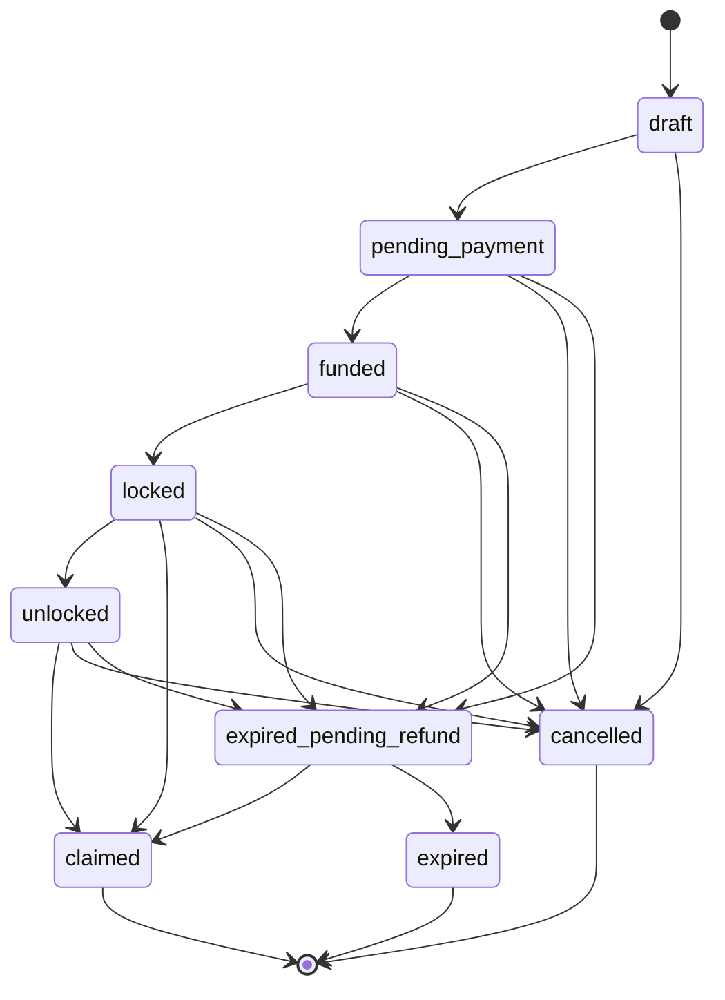

# Gift State Machine

This document describes the gift lifecycle state machine implemented in
`src/server/services/gift-state-machine.ts`. It shows every state, the allowed
transitions between them, and the errors raised when an invalid transition is
attempted.

## States

| State | Description |
| --- | --- |
| `draft` | Gift created but not yet submitted for payment. |
| `pending_payment` | Gift is awaiting payment confirmation. |
| `funded` | Payment received; gift is funded and awaiting locking. |
| `locked` | Gift funds are locked and the gift is ready to be claimed. |
| `unlocked` | Gift has been unlocked (e.g. by the sender) and is claimable. |
| `claimed` | Gift has been claimed by the recipient. |
| `cancelled` | Gift was cancelled before being claimed. |
| `expired_pending_refund` | Gift expired and is awaiting refund processing. |
| `expired` | Gift has fully expired and been refunded. |

## State Diagram



> The transitions above mirror the `TRANSITIONS` map in
> `gift-state-machine.ts`. If you add or remove a transition there, update this
> diagram in the same change.

## Invalid Transitions

Any transition not listed in the diagram is rejected by
`assertValidTransition`. The function throws an error with the message:

```
Invalid gift status transition: "<from>" → "<to>"
```

At the API layer this is surfaced as the error code `GIFT_INVALID_STATE`
(HTTP `409 Conflict`), documented in
[`docs/api-auth-and-errors.md`](../api-auth-and-errors.md).

Common invalid transitions include:

| From | To | Why it is invalid |
| --- | --- | --- |
| `claimed` | `funded` | A claimed gift is terminal; it cannot be re-funded. |
| `claimed` | `locked` | A claimed gift is terminal; it cannot be re-locked. |
| `cancelled` | `locked` | A cancelled gift is terminal; it cannot be locked. |
| `cancelled` | `claimed` | A cancelled gift is terminal; it cannot be claimed. |
| `expired` | `claimed` | A fully expired gift is terminal; it cannot be claimed. |
| `expired` | `funded` | A fully expired gift is terminal; it cannot be re-funded. |
| `draft` | `claimed` | A draft must be funded and locked before it can be claimed. |
| `pending_payment` | `locked` | Payment must be confirmed (`funded`) before locking. |
| `funded` | `claimed` | Funds must be locked before a gift can be claimed. |

All of the above raise `Invalid gift status transition: "<from>" → "<to>"`
and map to `GIFT_INVALID_STATE` (HTTP 409) at the API boundary.

## Expiry Grace Period

When a gift expires it first moves to `expired_pending_refund` rather than
directly to `expired`. During this grace period the gift may still be claimed:
`expired_pending_refund → claimed` is an allowed transition. This gives
recipients a short window to claim a gift that has technically expired but has
not yet been refunded.

Once the grace period elapses and the refund is processed, the gift moves to
the terminal `expired` state and can no longer be claimed.